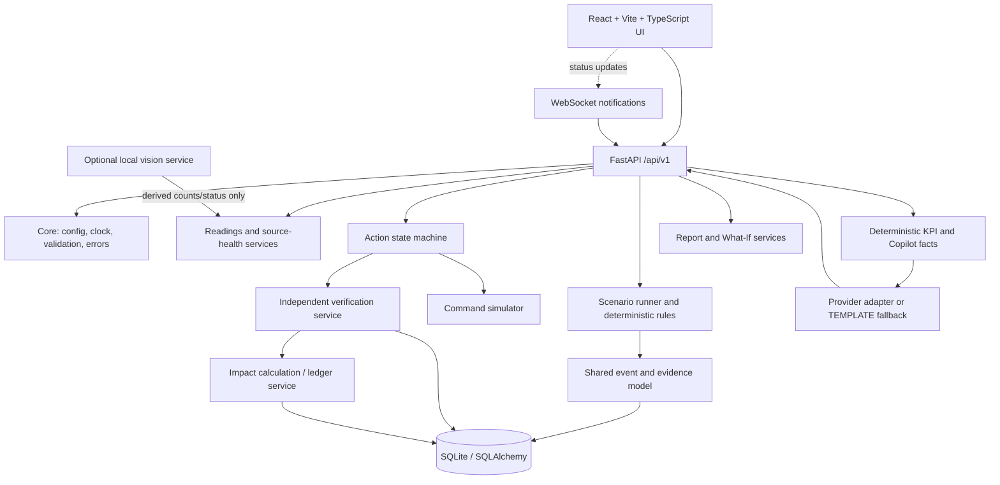
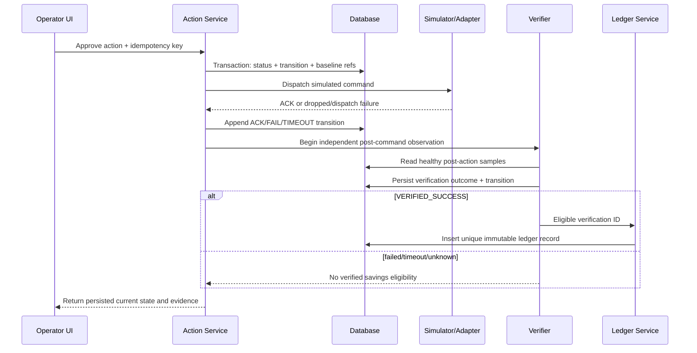

> **Implementation status:** the originally proposed ownership boundaries remain useful for maintenance, but the account workstreams have now been registered by the integration merge. See [`MERGE_REPORT.md`](MERGE_REPORT.md) for the current application layout and remaining release gate.

---

# Architecture Overview

## Component and data-flow overview



## Module dependency constraints

- `core` and shared schemas must not import UI concerns.
- Event/rule services depend on the shared reading/evidence schemas; they must not create resource-specific parallel event systems.
- Actions call a simulator/adapter and verification service; they do not calculate savings directly in UI code.
- The verifier creates a durable result; the ledger service consumes only eligible verification results.
- Copilot consumes a structured, server-created facts object and cannot write evidence, actions, KPIs or ledger entries.
- Reports read persisted facts and preserve provenance/assumptions.
- The optional vision service sends derived counts/status to the core domain. Raw frames never reach database, logs, reports or LLM.
- Feature routers export `APIRouter` objects under their assigned prefixes. Account 9 registers them in the central application.
- SQLite is the initial source of truth. WebSocket notifications can prompt refetch but never substitute for persisted REST state.

## Recommended repository layout (adapt to the existing repository)

```text
.
├── backend/
│   └── app/
│       ├── main.py                 # Account 9 only
│       ├── core/                   # A2
│       ├── db/                     # A2
│       ├── schemas/                # shared schemas: A2; frozen contract
│       ├── services/               # core/facts: A2; actions/verify: A3
│       ├── simulator/              # A3
│       ├── rules/                  # A3
│       ├── vision/                 # A4
│       ├── copilot/                # A7
│       ├── what_if/                # A7
│       └── routers/                # module owner exports; A9 registration
├── frontend/
│   └── src/
│       ├── app/                    # A5
│       ├── api/                    # A5
│       ├── components/shared/      # A5
│       └── features/
│           ├── camera/             # A4
│           ├── twin/               # A6
│           ├── charts/             # A6
│           ├── copilot/             # A7
│           └── what-if/            # A7
├── vision/                          # A4 local model instructions/artifacts policy
├── docs/                            # A1 architecture; A8 release docs/algorithm updates
├── contracts/examples/              # canonical examples
├── scripts/                          # A8; release integration from A9
└── tests/                            # A2/A3 unit tests; A8 integration/E2E
```

## Sequence diagram: approved intervention



## Important architectural boundary

The state machine is not a front-end animation. The current action state and append-only transition record are written by backend services. A UI can show progress only after receiving a persisted response or refetching authoritative state.
